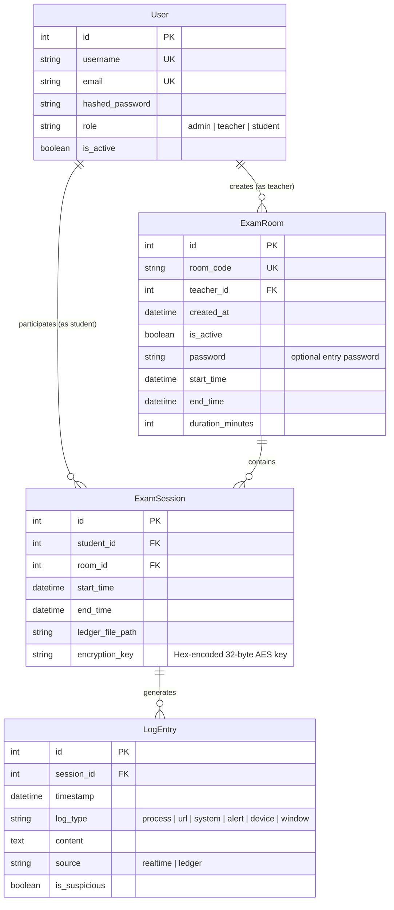
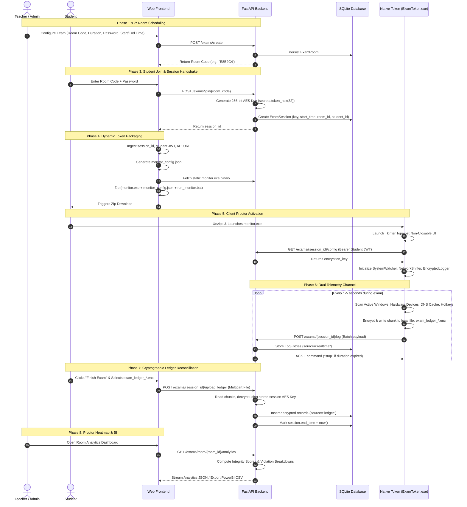

# Secure Token-Based Malpractice Prevention System
## Complete System Architecture, Threat Model, Technical Workflow, and Specification

> **Document Purpose**: This document provides a comprehensive, end-to-end technical explanation of the **Secure Token-Based Malpractice Prevention System** (also known as *Secure Exam Monitor*). It is designed to brief technical teams, architects, and AI reasoning models (such as Anthropic Claude) on the exact design, data flow, cryptographic protocols, security controls, and codebase implementation.

---

## Table of Contents
1. [Executive Summary & Core Objectives](#1-executive-summary--core-objectives)
2. [High-Level System Architecture](#2-high-level-system-architecture)
3. [Technology Stack & Dependency Mapping](#3-technology-stack--dependency-mapping)
4. [Database & Data Models (Entity-Relationship)](#4-database--data-models-entity-relationship)
5. [End-to-End System Workflow (Lifecycle)](#5-end-to-end-system-workflow-lifecycle)
   - [Phase 1: Authentication & Role Provisioning](#phase-1-authentication--role-provisioning)
   - [Phase 2: Exam Room Scheduling & Parameterization](#phase-2-exam-room-scheduling--parameterization)
   - [Phase 3: Student Session Handshake & Key Generation](#phase-3-student-session-handshake--key-generation)
   - [Phase 4: Dynamic Client Token Packaging & Distribution](#phase-4-dynamic-client-token-packaging--distribution)
   - [Phase 5: Native Client Proctor Execution (The Token Engine)](#phase-5-native-client-proctor-execution-the-token-engine)
   - [Phase 6: Real-Time Telemetry & Dual-Channel Logging](#phase-6-real-time-telemetry--dual-channel-logging)
   - [Phase 7: Cryptographic Ledger Submission & Offline Reconciliation](#phase-7-cryptographic-ledger-submission--offline-reconciliation)
   - [Phase 8: Proctoring Analytics, Scoring & BI Export](#phase-8-proctoring-analytics-scoring--bi-export)
6. [Subsystem Deep Dives](#6-subsystem-deep-dives)
   - [6.1 Native Exam Monitor (`tokens/monitor.py`)](#61-native-exam-monitor-tokensmonitorpy)
   - [6.2 System & Hardware Watcher (`tokens/system_watcher.py`)](#62-system--hardware-watcher-tokenssystem_watcherpy)
   - [6.3 Network & DNS Sniffer (`tokens/network_sniffer.py`)](#63-network--dns-sniffer-tokensnetwork_snifferpy)
   - [6.4 Cryptographic Ledger & Engine (`shared/crypto_utils.py` & `tokens/logger.py`)](#64-cryptographic-ledger--engine-sharedcrypto_utilspy--tokensloggerpy)
   - [6.5 Backend REST API & Services (`backend/routers/exam.py`, `auth.py`)](#65-backend-rest-api--services-backendroutersexampy-authpy)
   - [6.6 Frontend Dashboards & Visual Analytics (`frontend/src/`)](#66-frontend-dashboards--visual-analytics-frontendsrc)
7. [API Endpoint Specification](#7-api-endpoint-specification)
8. [Threat Model & Malpractice Detection Vector Coverage](#8-threat-model--malpractice-detection-vector-coverage)
9. [Directory Structure & Codebase Manifest](#9-directory-structure--codebase-manifest)
10. [Build, Packaging & Execution Instructions](#10-build-packaging--execution-instructions)

---

## 1. Executive Summary & Core Objectives

### The Problem
Traditional online examination and proctoring solutions suffer from severe trade-offs:
1. **Intrusive Kernel Drivers / Rootkits**: Some commercial anti-cheat tools install deep kernel drivers that raise severe security, stability, and privacy alarms for students.
2. **Web-Only Limitations**: Purely browser-based proctoring (JavaScript/WebExtensions) cannot detect external hardware changes, secondary keyboards, mobile tethering, DNS requests outside the tab, background applications (Discord, AnyDesk, TeamViewer), or operating system clipboard/window focus shifts.
3. **Network Fragility & Tampering**: If a student disconnects their Wi-Fi to cheat offline or intercepts network packets using proxies (e.g., Charles/Burp), telemetry is permanently lost or faked.

### The Solution: Secure Token-Based Architecture
The **Secure Token-Based Malpractice Prevention System** solves this via a lightweight, zero-kernel-admin proctoring token coupled with a dual-channel cryptographic verification protocol:
- **Zero Kernel Driver / Non-Admin Execution**: Monitors system processes, window focus, keyboard hotkeys, and DNS activity using native OS user-space APIs (Win32 GUI, WMI, Windows DNS Client Resolver Cache `DnsGetCacheDataTable`) without requiring administrator elevation.
- **Dual-Channel Cryptographic Telemetry**:
  1. **Real-time Channel**: HTTP periodic batch ingestion for live proctor observation.
  2. **Tamper-Evident Offline Ledger Channel**: An append-only local binary ledger (`.enc`) encrypted in **AES-256-GCM** with a per-session random key generated by the server. Even if network connection is lost or throttled, every event is sealed locally and decrypted on the server during post-exam reconciliation.
- **Automated Malpractice Scoring & Risk Stratification**: Dynamic algorithm calculating integrity scores ($0-100\%$) and categorizing students into risk tiers (`CLEAN`, `WARNING`, `CRITICAL`, `ZERO_LOGS`).

---

## 2. High-Level System Architecture

```mermaid
graph TD
    subgraph Client Workstation (Student)
        UI[React Student Dashboard\n:5173] -->|Downloads Dynamic Zip| ZIP[Exam Monitor Bundle\nmonitor.exe + monitor_config.json]
        ZIP -->|Runs Executable| TOKEN[Native ExamToken Engine\nTkinter Topmost Window]
        
        subgraph Token Monitor Subsystems
            SW[System Watcher\nWin32 GUI + WMI + psutil + Hotkeys]
            NS[Network Sniffer\nWindows DNS Cache API ctypes]
            LOG[Encrypted Logger\nAES-256-GCM Binary Ledger]
        end
        
        TOKEN --> SW
        TOKEN --> NS
        SW --> LOG
        NS --> LOG
        LOG -->|Local Storage| ENC[Local Encrypted Ledger\nexam_ledger_session_*.enc]
    end

    subgraph Server Infrastructure
        API[FastAPI Backend Server\n:8000 / Uvicorn]
        DB[(SQLite / SQLAlchemy DB\nexam_monitor.db)]
        STORAGE[Encrypted Ledger Vault\nbackend/ledgers/]
    end

    subgraph Proctor / Faculty Workstation
        TEACHER[Teacher / Admin Dashboard\nLive Heatmaps, Recharts & PowerBI Export]
    end

    %% Network Communications
    UI -->|JWT Auth & Join Exam| API
    TOKEN -->|Fetch 32-Byte Session Key| API
    LOG -->|Real-Time Batch POST /log| API
    UI -->|Post-Exam Upload .enc Ledger| API
    API --> DB
    API --> STORAGE
    API -->|Aggregated Analytics & CSV Stream| TEACHER
```

---

## 3. Technology Stack & Dependency Mapping

### Backend
- **Framework**: `FastAPI` (Python asynchronous REST framework)
- **ASGI Server**: `Uvicorn`
- **ORM & Database**: `SQLAlchemy` ORM with SQLite backend (`exam_monitor.db` / `exam_monitor_v2.db`)
- **Authentication**: `OAuth2PasswordRequestForm`, `python-jose` (JWT Bearer Token signing with HS256), `passlib[bcrypt]` (salted hashing)
- **Data Serialization**: `Pydantic v2` schemas
- **File & Ledger Processing**: Python standard libraries `io`, `csv`, `secrets`, `os`, `base64`, `json`

### Native Token Proctor Client
- **Runtime**: Python 3.8+ compiled via `PyInstaller` into standalone Windows binary (`ExamToken.exe` / `monitor.exe`)
- **GUI Framework**: `Tkinter` (compact, topmost, non-resizable, window-close interceptor)
- **OS Introspection**:
  - `psutil`: Process enumeration and disk partition detection
  - `pywin32` (`win32gui`, `win32process`, `pythoncom`): Foreground window monitoring and thread apartment initialization
  - `wmi`: Windows Management Instrumentation queries for pointing devices, keyboards, USB hubs, and Windows Portable Devices (WPD)
  - `ctypes` & `wintypes`: Dynamic access to `dnsapi.dll` (`DnsGetCacheDataTable`) for zero-admin DNS resolution cache snooping
  - `keyboard`: Low-level OS keyboard hotkey listeners for copy/paste detection (`Ctrl+C`, `Ctrl+V`)
- **Cryptography**: `cryptography.hazmat` (AES-256-GCM symmetric cipher, PKCS7 / raw stream padding)

### Frontend
- **Framework**: React 18 (Vite build tool)
- **Styling**: Vanilla CSS + TailwindCSS (v4) with custom futuristic dark glassmorphism design tokens
- **Routing**: `react-router-dom` v7 with role-based `ProtectedRoute` guards
- **Visual Analytics**: `Recharts` (Pie charts, Stacked Bar charts, Area charts)
- **Packaging & Archive Creation**: `jszip` (dynamic in-browser ZIP bundle creation) and `file-saver`
- **Icons**: `lucide-react`
- **HTTP Client**: `axios` with automatic JWT interceptors

---

## 4. Database & Data Models (Entity-Relationship)



### Relational Behaviors & Cascades
- Deleting an `ExamRoom` cascades deletions to all associated `ExamSession` records and their child `LogEntry` records (`cascade="all, delete-orphan"`).
- Deleting a user cleans up both authored exam rooms (for teachers) and completed exam sessions (for students).

---

## 5. End-to-End System Workflow (Lifecycle)



---

## 6. Subsystem Deep Dives

### 6.1 Native Exam Monitor (`tokens/monitor.py`)
- **Initialization & Argument Precedence**:
  1. CLI Arguments: `python monitor.py <api_url> <jwt_token> <session_id> <username>`
  2. Configuration File: Reads adjacent `monitor_config.json` (auto-detects frozen directory in PyInstaller bundles via `sys.frozen`).
- **GUI Guard Rails**:
  - Initializes a Tkinter UI window fixed to `300x180`.
  - Sets `-topmost = True` so that the monitor remains on top of distractions.
  - Overrides the `WM_DELETE_WINDOW` protocol with `on_closing()`, explicitly preventing manual closure until server termination commands are issued.
- **Worker Threading Matrix**:
  - `watcher_thread`: Daemon running `SystemWatcher.start()`
  - `sniffer_thread`: Daemon running `NetworkSniffer.start()`
  - `monitor_thread`: Daemon periodically flushing and uploading telemetry every 5 seconds.
  - `Tkinter.mainloop()`: Blocks main thread for GUI responsiveness.

### 6.2 System & Hardware Watcher (`tokens/system_watcher.py`)
This subsystem guards against external assistance, secondary hardware, virtualized sandboxes, and clipboard cheats:

1. **Active Window Focus Snooping**:
   - Uses `win32gui.GetForegroundWindow()` and `win32gui.GetWindowText()`.
   - **AI & Solution Keyword Engine**: Identifies web titles containing `chat`, `gpt`, `claude`, `gemini`, `perplexity`, `chegg`, `stackoverflow`, `deepseek`, `copilot`, `phind`, etc. Triggers `ALERT` with `is_suspicious=True`.
   - **Unauthorized Communications & Remote Control**: Scans window titles for `discord`, `telegram`, `whatsapp`, `zoom`, `teams`, `slack`, `anydesk`, `teamviewer`, `rustdesk`.
   - **Storage & Peripheral Exploration**: Flags titles matching `file explorer`, `iphone`, `android`, `usb drive`, `sd card`.

2. **Process Integrity Auditing**:
   - Enumerates running OS processes every second using `psutil.process_iter(['name'])`.
   - Compares against forbidden process signatures (`discord`, `skype`, `anydesk`, etc.).

3. **Virtual Machine & Sandbox Detection**:
   - **MAC OUI Fingerprinting**: Resolves local network adapter MAC via `uuid.getnode()` and tests prefixes against known hypervisor vendors:
     - `00:05:69`, `00:0C:29`, `00:1C:14`, `00:50:56` (VMware)
     - `00:15:5D` (Microsoft Hyper-V)
     - `08:00:27` (Oracle VirtualBox)
   - **Driver Artifact Check**: Checks for existence of virtualization driver binaries in `C:\Windows\System32\drivers\`:
     - `VBoxMouse.sys`, `vmmouse.sys`, `wmbus.sys`.

4. **Hardware Peripheral Hotplug & Device Fingerprinting**:
   - Queries Windows Management Instrumentation (`wmi.WMI()`) to establish a hardware baseline prior to exam start.
   - Monitors 5 device classes:
     - `Win32_PointingDevice` (Mice)
     - `Win32_Keyboard` (Keyboards)
     - `Win32_PnPEntity(PNPClass='WPD')` (Smartphones / Portable Devices / Media Players)
     - `Win32_DiskDrive(InterfaceType='USB')` (Flash drives)
     - `Win32_USBHub` & `psutil.disk_partitions(removable=True)`
   - **Composite Peripheral Deduplication**: Hardware dongles often report multiple handles (e.g., a gaming mouse registering both a pointing device and a secondary virtual keyboard). The `get_base_id()` method parses regular expressions for `VID_[0-9A-Fa-f]{4}&PID_[0-9A-Fa-f]{4}` to unify handles into single physical hardware IDs, eliminating false peripheral alerts.
   - Any hardware added during the exam triggers a real-time `DEVICE` alert.

5. **Clipboard & Hotkey Interception**:
   - Uses low-level Windows keyboard hooks via `keyboard.add_hotkey('ctrl+c', ...)` and `ctrl+v`.
   - Flags prohibited copy/paste behavior directly into the telemetry pipeline.

### 6.3 Network & DNS Sniffer (`tokens/network_sniffer.py`)
Traditional network sniffing requires Administrator privileges or Npcap/WinPcap drivers to open raw sockets. This project bypasses this barrier through the **Windows DNS Client Resolver Cache**:
- Invokes native `dnsapi.dll` via Python `ctypes`.
- Calls `DnsGetCacheDataTable(ctypes.byref(pEntry))` to traverse linked list entries (`DNS_CACHE_ENTRY`).
- **Baseline Exclusion**: On startup, snapshots all currently resolved domains so pre-existing browser visits are not penalized.
- **Real-Time Detection**: Continuously interrogates newly resolved domains every second. Domains matching prohibited keywords (`openai`, `claude`, `anthropic`, `gemini`, `chegg`, `stackoverflow`, etc.) immediately trigger `ALERT` with `is_suspicious=True`.

### 6.4 Cryptographic Ledger & Engine (`shared/crypto_utils.py` & `tokens/logger.py`)
Provides offline resilience, mathematical tamper evidence, and zero-knowledge storage on the client side:
- **Cipher**: **AES-256-GCM** (Galois/Counter Mode). GCM provides both confidentiality and built-in cryptographic authentication tags (AEAD).
- **Session Key Generation**: Server-generated via cryptographically secure random bytes: `secrets.token_hex(32)`.
- **Initialization Vector (IV)**: Fresh, cryptographically random 12-byte IV generated per chunk via `os.urandom(12)`.
- **Ledger Binary Framing**:
  The ledger file `exam_ledger_<username>_session_<id>_exam.enc` is composed of contiguous, length-prefixed blocks:
  ```
  +-----------------------+-------------------------------------------------------------+
  | Length Prefix (4 bytes)| JSON Payload (iv_b64, ciphertext_b64, tag_b64)             |
  | Big-Endian Integer    | Encrypted array of LogEntry dictionaries                   |
  +-----------------------+-------------------------------------------------------------+
  ```
- **Integrity Guarantee**: If a student attempts to tamper with or modify any bytes in the `.enc` ledger, the GCM authentication tag verification fails on the backend during upload, immediately flagging file tampering.

### 6.5 Backend REST API & Services (`backend/routers/exam.py`, `auth.py`)
- **Authentication**: JWT tokens signed with a secret key containing claims `{"sub": username, "role": role}`.
- **Session Lifecycles & Termination Control**:
  - Monitors student active durations relative to `ExamRoom.duration_minutes`.
  - When duration expires or student initiates exit, the response to `POST /exams/{session_id}/log` returns `{"command": "stop"}`. The native monitor reads this and gracefully triggers shutdown and ledger save.
- **Ledger Decryption & Ingestion (`upload_ledger`)**:
  - Reads length headers, decodes JSON packets, invokes `CryptoUtils.decrypt()`, parses timestamps, and inserts rows into `LogEntry` with `source="ledger"`.
- **Malpractice Analytics & Scoring Algorithm**:
  ```python
  if total_logs == 0:
      risk_tier = "ZERO_LOGS"
      integrity_score = 0
  elif suspicious_logs >= 3:
      risk_tier = "CRITICAL"
      integrity_score = max(5, 100 - (suspicious_logs * 15))
  elif suspicious_logs >= 1:
      risk_tier = "WARNING"
      integrity_score = max(50, 100 - (suspicious_logs * 15))
  else:
      risk_tier = "CLEAN"
      integrity_score = 100
  ```
- **Export Engines**:
  - `/export_csv`: Comprehensive raw log dump for CSV parsing.
  - `/export_logs_txt`: Human-readable formatted forensic audit transcript with `[SUSPICIOUS]` and `[OFFLINE]` flags.
  - `/export_powerbi`: Specialized dimensional schema optimized for direct import into Microsoft PowerBI or Tableau (includes Session IDs, Risk Tiers, Alerts per category, Top Violations, and completion states).

### 6.6 Frontend Dashboards & Visual Analytics (`frontend/src/`)
- **Admin Dashboard (`AdminDashboard.jsx`)**:
  - Complete user management: create users, search, promote/demote roles (`student` $\leftrightarrow$ `teacher` $\leftrightarrow$ `admin`), delete users (with full database cascading cleanup).
- **Teacher Dashboard (`TeacherDashboard.jsx`)**:
  - Exam creation modal: duration in minutes, start/end dates, optional password.
  - Exam room roster with active student badges and direct navigation to detailed analytics.
- **Live Exam Analytics & Investigation (`ExamDetails.jsx`)**:
  - **Recharts Data Visualizations**:
    - Risk Tier Distribution Pie Chart (Clean, Low Risk, Critical, Zero Logs).
    - Violation Category Breakdown Bar Chart (Device Tampering, Window Switching, Clipboard Hotkeys, VM, Network DNS).
    - Real-Time Incident Timeline Area Chart (normal vs. suspicious log frequency across time).
  - **Student Roster & Drill-Down**:
    - Filter students by risk tier (`CRITICAL`, `WARNING`, `CLEAN`, `ZERO_LOGS`).
    - Inspection drawer allowing proctors to switch between **Realtime Telemetry** and **Offline Encrypted Ledger** records.
  - **One-Click Export**:
    - Export PowerBI CSV with pre-configured headers.
    - Export raw CSV.
    - Export individual student forensic report (`.txt`).
- **Student Dashboard (`StudentDashboard.jsx`)**:
  - Room Code + Password entry.
  - In-browser packaging engine (`JSZip`): dynamically packages the executable, configuration file with auth token, and launcher script into a downloadable archive.
  - Post-exam encrypted ledger upload interface with instant confirmation and status tracking.

---

## 7. API Endpoint Specification

### Authentication Service (`/auth`)
| Method | Path | Auth Required | Description |
|---|---|---|---|
| `POST` | `/auth/register` | No | Creates student account |
| `POST` | `/auth/token` | No | Verifies credentials, returns Bearer JWT |
| `GET` | `/auth/me` | Yes (Any) | Returns authenticated user context |
| `GET` | `/auth/admin/users` | Yes (Admin) | Lists all system users |
| `POST` | `/auth/admin/users` | Yes (Admin) | Creates new user with explicit role |
| `PUT` | `/auth/admin/users/{id}/role` | Yes (Admin) | Updates role (`student`, `teacher`, `admin`) |
| `DELETE`| `/auth/admin/users/{id}` | Yes (Admin) | Deletes user and cascades associated rooms/sessions |

### Examination Service (`/exams`)
| Method | Path | Auth Required | Description |
|---|---|---|---|
| `POST` | `/exams/create` | Teacher / Admin | Generates unique 6-character room code & schedules exam |
| `GET` | `/exams/list` | Teacher / Admin | Lists created rooms with active and completed student tallies |
| `POST` | `/exams/join/{room_code}` | Student | Validates schedule & password, creates session & AES key |
| `GET` | `/exams/room/{room_id}/students` | Teacher / Admin | Returns student sessions belonging to room |
| `GET` | `/exams/{session_id}/config` | Student (Owner) | Delivers session-specific 32-byte encryption key to token |
| `POST` | `/exams/{session_id}/log` | Student (Owner) | Ingests real-time batch logs; sends `stop` command if expired |
| `GET` | `/exams/{session_id}/logs` | Student / Teacher | Fetches logs for session (optional `?source=ledger` filter) |
| `GET` | `/exams/room/{room_id}/logs` | Teacher / Admin | Fetches all logs for entire exam room |
| `POST` | `/exams/{session_id}/upload_ledger` | Student (Owner) | Decrypts uploaded `.enc` file and imports offline logs |
| `GET` | `/exams/room/{room_id}/analytics` | Teacher / Admin | Aggregates room-level metrics, violation charts, risk tiers |
| `GET` | `/exams/room/{room_id}/export_powerbi` | Teacher / Admin | Generates PowerBI-ready CSV with formatted columns |
| `GET` | `/exams/room/{room_id}/export_csv` | Teacher / Admin | Exports room logs as raw CSV |
| `GET` | `/exams/{session_id}/export_logs_txt` | Teacher / Admin | Formatted text report for individual student session |
| `GET` | `/exams/{session_id}/download_ledger` | Teacher / Admin | Downloads raw `.enc` file stored in backend vault |
| `POST` | `/exams/leave/{session_id}` | Student (Owner) | Flags session end time |
| `DELETE`| `/exams/room/{room_id}` | Teacher / Admin | Deletes exam room and cascades orphan records |

---

## 8. Threat Model & Malpractice Detection Vector Coverage

| Threat Vector | Cheating Mechanism | System Detection Countermeasure | Output Log Category | Severity |
|---|---|---|---|---|
| **External AI Assistance** | Student opens ChatGPT, Claude, Gemini, Perplexity in browser | Window title matcher & Windows DNS Cache resolution sniffer | `ALERT` | **CRITICAL** |
| **Secondary Input Devices** | Student connects unauthorized mouse or keyboard for assistant | WMI PnP device monitor comparing active devices against initial baseline | `DEVICE` | **CRITICAL** |
| **Smartphones / Tethering** | Student plugs phone via USB to transfer answers | WMI `Win32_PnPEntity(PNPClass='WPD')` detection | `DEVICE` | **CRITICAL** |
| **External Flash Drives** | Student inserts USB thumb drive with notes | WMI `Win32_DiskDrive` and `psutil.disk_partitions` removable checks | `DEVICE` | **CRITICAL** |
| **Clipboard Sharing** | Student copies question text or pastes answers from clipboard | Global Windows keyboard hotkey listeners (`Ctrl+C`, `Ctrl+V`) | `ALERT` | **CRITICAL** |
| **Remote Screen Sharing** | Student launches AnyDesk, TeamViewer, UltraViewer, Discord | Process scanner (`psutil`) + Foreground window title introspection | `ALERT` | **CRITICAL** |
| **Virtual Machine Sandbox** | Student runs proctor in VM while cheating on host | MAC address OUI inspection + VM kernel driver binary presence check | `ALERT` | **CRITICAL** |
| **Network Disconnection** | Student disables Wi-Fi to evade cloud telemetry | Local append-only AES-256-GCM binary ledger records events offline | `Ledger Audit` | **CRITICAL** |
| **Telemetry Tampering** | Student alters telemetry packets in flight or edits local file | AES-256-GCM authentication tags fail validation if bytes are altered | `Decryption Fail` | **FATAL** |
| **Process Termination** | Student attempts to kill the monitor window | Tkinter window closure interception (`WM_DELETE_WINDOW`) | `SYSTEM` | **WARNING** |

---

## 9. Directory Structure & Codebase Manifest

```
Secure-Token-Based-Malpractice-Prevention/
├── README.md                          # Base setup documentation
├── requirements.txt                   # Backend & Token Python dependencies
├── build_token.py                     # Root PyInstaller build script for ExamToken.exe
├── monitor.spec                       # PyInstaller build specification
│
├── backend/                           # FastAPI Backend Service
│   ├── main.py                        # App initialization, CORS, static mounts, admin seeder
│   ├── database.py                    # SQLAlchemy engine and SessionLocal setup
│   ├── models.py                      # Database models (User, ExamRoom, ExamSession, LogEntry)
│   ├── schemas.py                     # Pydantic validation schemas
│   ├── auth.py                        # JWT utilities, bcrypt hashing, current_user dependencies
│   ├── ledgers/                       # Vault where uploaded student .enc files are stored
│   ├── static/                        # Static folder serving monitor.exe to web clients
│   └── routers/
│       ├── auth.py                    # User authentication, role administration, user deletion
│       └── exam.py                    # Exam lifecycle, telemetry ingest, decryption, analytics
│
├── tokens/                            # Native Client Proctor Application
│   ├── monitor.py                     # Main client loop, Tkinter UI, config fetcher, upload loop
│   ├── system_watcher.py              # OS watcher (windows, processes, devices, hotkeys, VMs)
│   ├── network_sniffer.py             # Zero-admin DNS client resolver cache snooper
│   ├── logger.py                      # EncryptedLogger handling local AES-256 binary ledger
│   └── shared/                        # Mirrored crypto utilities for PyInstaller bundle
│
├── shared/                            # Shared Core Utilities
│   ├── __init__.py
│   └── crypto_utils.py                # AES-256-GCM encryption/decryption, HMAC, keygen
│
├── frontend/                          # React + Vite Web Client
│   ├── package.json                   # Node dependencies (Recharts, JSZip, Lucide, Tailwind)
│   ├── vite.config.js                 # Vite configuration
│   └── src/
│       ├── main.jsx                   # Entry point
│       ├── App.jsx                    # Route definitions and ProtectedRoute guards
│       ├── index.css / App.css        # Styles and custom scrollbar tokens
│       ├── api/
│       │   └── axios.js               # Axios instance with Bearer token interceptors
│       ├── context/
│       │   └── AuthContext.jsx        # Auth state, login/logout, JWT decode
│       └── pages/
│           ├── Login.jsx              # User login
│           ├── Register.jsx           # Student registration
│           ├── StudentDashboard.jsx   # Exam join, in-browser token zip packager, ledger upload
│           ├── TeacherDashboard.jsx   # Exam creation modal, exam list overview
│           ├── ExamDetails.jsx        # Live analytics, charts, logs drawer, PowerBI export
│           └── AdminDashboard.jsx     # User management, role assignment, account deletion
│
├── scripts/                           # Utility & Diagnostic Scripts
│   ├── build_token.py                 # Secondary builder
│   ├── migrate_db.py                  # Schema migration utility
│   ├── test_ledger_upload.py          # Unit test for ledger serialization/decryption
│   └── run_verification.py            # Automated end-to-end verification script
│
└── tests/                             # Integration Test Suite
    ├── test_key_exchange.py           # Validates 32-byte key delivery
    ├── test_log_upload.py             # Validates real-time batch logging
    └── test_full_flow.py              # Full end-to-end headless integration run
```

---

## 10. Build, Packaging & Execution Instructions

### 1. Backend Setup & Run
```bash
# In project root:
python -m venv venv
venv\Scripts\activate

pip install -r requirements.txt

# Run server on port 8000
uvicorn backend.main:app --reload --host 127.0.0.1 --port 8000
```
- API Documentation is available at `http://127.0.0.1:8000/docs`.
- Default Seeded Admin Account: `admin` / `123456`.

### 2. Compiling the Native Token Client
When modifying `tokens/monitor.py`, `system_watcher.py`, or `network_sniffer.py`, recompile the binary:
```bash
python build_token.py
```
This builds `dist/ExamToken.exe`. Ensure the resulting executable is copied to `backend/static/monitor.exe` so the frontend can bundle it:
```bash
copy dist\ExamToken.exe backend\static\monitor.exe
```

### 3. Frontend Setup & Run
```bash
cd frontend
npm install
npm run dev
```
- Access web application at `http://localhost:5173`.

### 4. Running Verification Test
To run an automated integration verification test without manual UI interactions:
```bash
python scripts/run_verification.py
```
This will start an in-process Uvicorn server, generate a teacher and student, schedule an exam room, join, simulate encrypted log generation, upload the ledger, decrypt the payload, and assert that all logs match expected integrity baselines.
